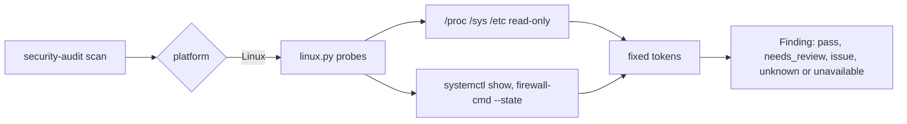

# Linux checks

**Validation status:** the Linux adapter is implemented and covered by synthetic
`/proc`, `/sys` and `/etc` fixtures in the unit tests. **No Linux physical-device
validation has been performed**, on any distribution. Fixture tests, CI runner
results and runs in a cloud sandbox or VM are not device validation. Treat every
Linux result as a triage signal, not a verdict.

Linux support is **read-only**: no root, no privilege escalation, no repair, no OS or
service setting changes, and no credential inspection. The tool makes no network
request.

## Usage

```sh
python3 -m pip install -e .        # Python 3.11+, no runtime dependencies
security-audit scan                # all categories
security-audit scan os             # OS-L01..OS-L05
security-audit scan network        # non-loopback TCP listeners
security-audit scan browser        # Chrome-family and Firefox discovery
security-audit report --format json --output reports/latest.json   # mode 0600
security-audit coverage            # implementation / fixture / device matrix
security-audit fix                 # previews nothing, changes nothing (exit 0)
security-audit fix --apply         # unsupported: error on stderr, exit 2, nothing changed
```

Run as a normal user. Running as root is not required and gives no extra coverage.
`scan` and `report` behave as before (exit 0). `fix` never previews or applies a change on
Linux; `fix --apply` fails with exit 2 so automation cannot read it as a successful repair.
`scan --full` searches only `~/Documents` and `~/Developer` for repositories; use
`--repository PATH` for other layouts. `password-checkup`, `browser-review`,
`--snapshot` and `--compare` behave as on macOS and Windows.

## How states are reported

Linux has many layouts, so an unanswered question is never reported as a pass.

| Meaning | Reported as | How to recognize it |
| --- | --- | --- |
| `unknown`: a supported layout, but the evidence is missing or unreadable (variable not visible, no firewall manager found, `systemctl` cannot reach the manager) | status `unknown` | title ends with "status unknown" or "No supported ... detected" |
| `not_supported`: the environment is outside what the adapter handles (WSL, non-systemd init, non-UEFI boot, a root that is not a block device such as a container overlay or ZFS) | status `unavailable`, evidence `unavailable`, limitation starts with `not_supported:` | the first limitation line |

The report schema is unchanged: `not_supported` is carried by the existing
`unavailable` state plus the limitation prefix rather than a new enum value.

## OS checks

| ID | Check | Source (read-only) | Result states |
| --- | --- | --- | --- |
| `OS-L01` | Disk encryption (FileVault counterpart) | Root mount source from `/proc/self/mountinfo`, mapped to its block device, then `/sys/dev/block/*/dm/uuid` (first 16 bytes, prefix test only) through at most 32 `slaves` nodes | `pass` when a LUKS/dm-crypt layer sits under `/`; `needs_review` when none is found; `not_supported` for overlay, ZFS, tmpfs or network roots; `unknown` when sysfs is unreadable |
| `OS-L02` | Firewall | `/etc/ufw/ufw.conf` `ENABLED=`; `firewall-cmd --state` only if that binary exists | `observed` (ufw configured enabled), `pass` (firewalld running), `needs_review` (manager present but disabled), `unknown` (none detected or unreadable) |
| `OS-L03` | Mandatory access control | `/sys/kernel/security/lsm`, `/sys/fs/selinux/enforce`, AppArmor module flag | `pass` SELinux enforcing; `needs_review` permissive or none; `observed` AppArmor active; `unknown` |
| `OS-L04` | Secure Boot | `SecureBoot-8be4df61-...` EFI variable (5 bytes) | `pass` / `issue` (off); `not_supported` without a visible UEFI interface; `unknown` |
| `OS-L05` | SSH server (Remote Login counterpart) | `systemctl show -p LoadState -p ActiveState` for `ssh`/`sshd` service and socket units | `needs_review` when active (including socket activation); `pass` when inactive or not installed; `not_supported` without systemd; `unknown` |

macOS Gatekeeper/SIP and Windows UAC/Defender have no Linux counterpart and produce no
finding. A missing dm-crypt layer is a review prompt, not an `issue`: hardware
self-encrypting drives, fscrypt/eCryptfs, raw `dmsetup` crypt targets and encryption
below a hypervisor cannot be detected. `CRYPT-VERITY-` and `CRYPT-INTEGRITY-` layers
are integrity layers and are not counted as encryption. `ufw.conf` shows configured
state, not loaded rules; nftables/iptables rule sets need elevated privileges and are
not read. Under WSL all five checks are `not_supported` because the guest does not own
host disk, firewall or firmware state; run the Windows checks on the host.

## Network listeners

`NET-001` lists non-loopback TCP listeners read from `/proc/net/tcp` and `tcp6`.
Reports contain only a port and `*` (wildcard) or `non-loopback address`. Addresses,
owning processes and service names are neither read nor reported. Only the network
namespace of the scanning process is visible, so a container shows its own listeners.
More than 50 endpoints, malformed lines or a partly unreadable table add an `NET-000`
"incomplete" finding. Binding beyond loopback does not establish Internet exposure.

## Existing checks on Linux

| Category | On Linux |
| --- | --- |
| `api`, `ssh`, `cloud`, `dev`, `ai` | Same POSIX mode-bit metadata checks as macOS (group/other access); file contents are never opened. Default XDG-style locations only (`XDG_CONFIG_HOME` overrides are not followed). |
| `git` | `.gitignore` presence; the history scan reminder only. |
| `browser` | See below. |
| Password Checkup | **Not automated.** The existing manual guidance and user-reported local record are shown unchanged; an unrecorded result stays `unknown`. |

Mode-bit checks do not evaluate POSIX ACLs, extended attributes, SELinux labels,
capabilities or the filesystem. Filesystems without POSIX permission semantics (some
FAT/NTFS/9p mounts) can show misleading modes. Distributions with user-private groups
and `umask 002` create `0664` files; the group bits are reported as broad even when the
group contains only you, so review ownership and group membership before acting.

### Browsers and distribution packaging

Roots checked per browser, in this order; only the first existing root is inspected and
`BR-014` reports that another one exists.

| Browser | Native | Flatpak | Snap |
| --- | --- | --- | --- |
| Chrome | `~/.config/google-chrome` | `~/.var/app/com.google.Chrome/config/google-chrome` | not covered |
| Brave | `~/.config/BraveSoftware/Brave-Browser` | `~/.var/app/com.brave.Browser/config/BraveSoftware/Brave-Browser` | not covered |
| Edge | `~/.config/microsoft-edge` | `~/.var/app/com.microsoft.Edge/config/microsoft-edge` | not covered |
| Firefox | `~/.mozilla/firefox` | `~/.var/app/org.mozilla.firefox/.mozilla/firefox` | `~/snap/firefox/common/.mozilla/firefox` |

Chrome gets bounded manifest declarations (same limits and redaction as other
platforms) and the managed policy files in `/etc/opt/chrome/policies/managed/*.json`
(at most 50 files of 256,000 bytes; symlinks, malformed or duplicate-key files are
`unknown`). Only whether `ExtensionSettings` is present and the
`SafeBrowsingProtectionLevel` enum are kept. Policy files are configured state, not
effective state; check `chrome://policy`. Brave and Edge are directory counts and
Firefox is presence only, as elsewhere. Chromium (any packaging), Brave/Edge Snaps,
cloud policy and Flatpak/Snap policy locations are not covered.

## Distribution environments

Expected behavior of the implemented logic; none of these were validated on a device.

| Environment | OS checks | Listeners | Browsers |
| --- | --- | --- | --- |
| systemd distributions (Debian/Ubuntu, Fedora/RHEL family, Arch, openSUSE) | all five | yes | native, Flatpak, Firefox Snap |
| Non-systemd init (OpenRC, runit, s6) | `OS-L05` is `not_supported`; others read what exists | yes | yes |
| Firewall managed only by nftables/iptables (for example NixOS defaults) | `OS-L02` is `unknown` | yes | yes |
| WSL | all `not_supported` | WSL guest namespace only | WSL profile directories only |
| Containers | root mapping usually `not_supported`; Secure Boot `not_supported` | container namespace only | container home only |
| Immutable/ostree desktops | as above | yes | Flatpak roots; fails closed if a parent of the browser data directory is a symlink |
| Other Unix (BSD, ...) | adapter unavailable | adapter unavailable | adapter unavailable |

Manual records under `~/.security-audit` and snapshot reads/writes fail closed if any
parent of the target is a symbolic link (for example a symlinked `/home`).

## What is read

Reads: `/proc/self/mountinfo` (2 MB cap; the root source is used in memory and never
reported), `/proc/net/tcp{,6}`, `/proc/sys/kernel/osrelease`, `/sys/dev/block/*`,
`/sys/kernel/security/lsm`, `/sys/fs/selinux/enforce`,
`/sys/module/apparmor/parameters/enabled`, the SecureBoot EFI variable,
`/etc/ufw/ufw.conf`, existence of `/run/systemd/system`, Chrome managed policy files,
and the existing browser manifests. Files are opened read-only without following a final
symlink and with fixed size caps. Fixed commands, run with absolute paths, no shell, no
stderr and an 8 KB output cap: `systemctl show ...` and `firewall-cmd --state`.

Never reported: device names, mount sources, UUIDs, IP addresses, process names, policy
contents, unit output, extension IDs/names/URLs, secret values.



## Verification

Run by the unit tests (`python -m unittest discover -s tests`, in CI on Ubuntu, macOS and
Windows runners): synthetic trees for every state above, unknown-environment and WSL
behavior, secret-canary and read-only checks (no write flags, no unexpected subprocess,
credential files never opened), compatibility of macOS/Windows findings, and the
Linux-read-only `fix` behavior. Tests that create Linux sysfs `major:minor` paths run
on Ubuntu and macOS because Windows cannot represent those directory names; the
`fix --apply` unsupported exit code is also checked on Windows.

Not run: any Linux physical-device or per-distribution validation, real firmware or
real encrypted-root layouts, and real `ufw`, `firewalld` or `systemd` hosts.
